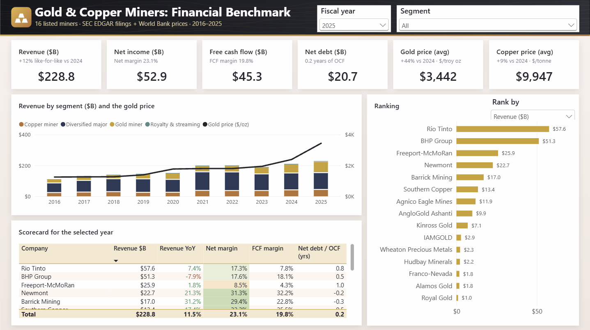
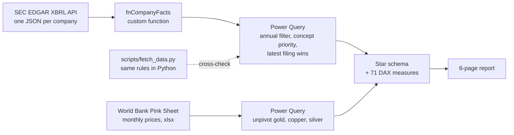
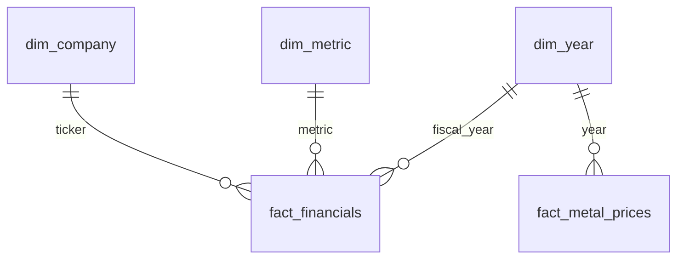
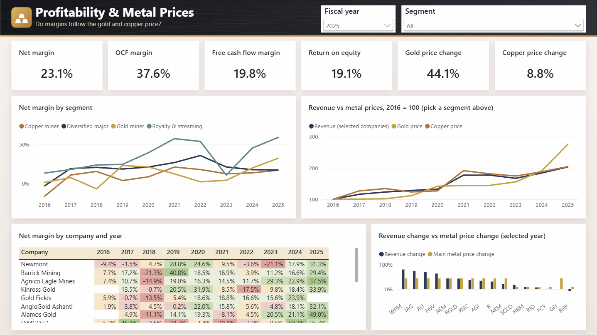
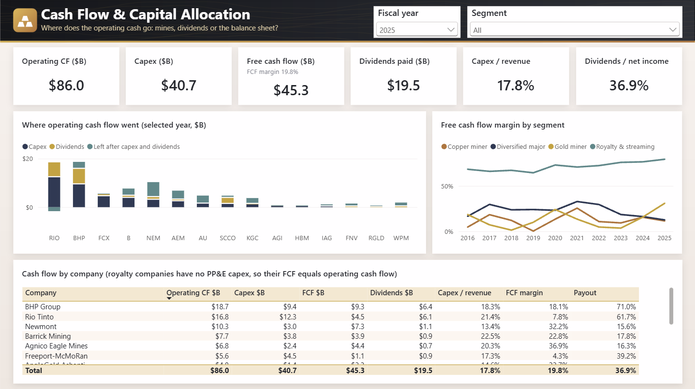
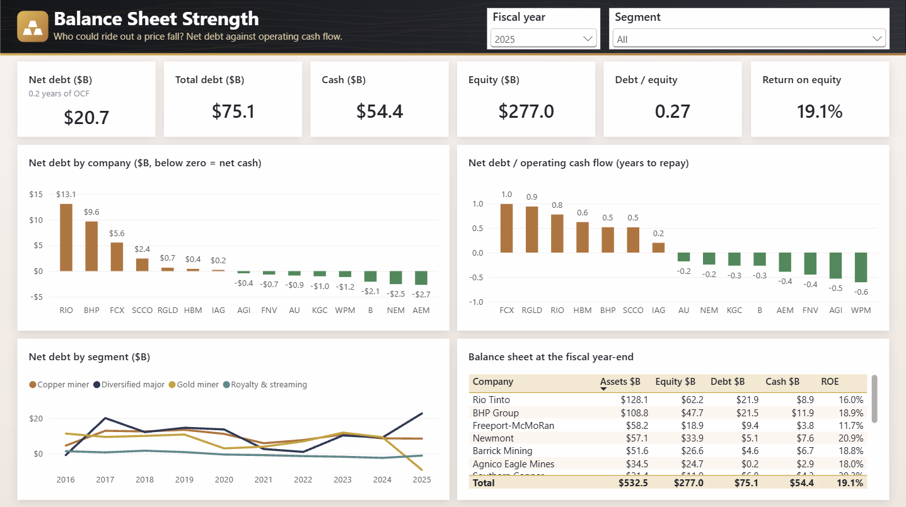
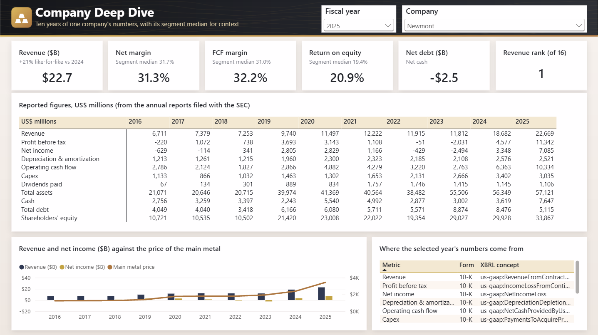
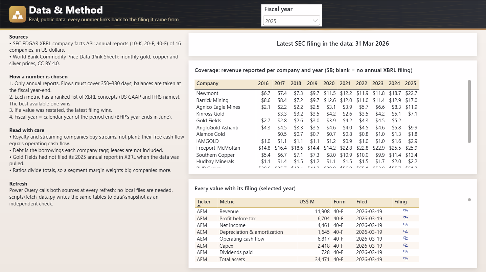

# Gold & Copper Miners: Financial Benchmark (Power BI)

A six-page Power BI report that compares **16 listed gold, copper, diversified and royalty companies** over ten fiscal years (2016–2025). It answers the questions a mining analyst, investor or finance team asks:

- Did the record gold price turn into profit and cash, or was it lost to costs?
- Which companies and business models earn the best margins?
- Where does the operating cash go: new mines, dividends or debt repayment?
- Who has the balance sheet to get through a price fall?

> **Data: real and public, no synthetic numbers.**
> - Company figures come from the annual reports (10-K, 20-F, 40-F) each company files with the US SEC, read through the free **SEC EDGAR XBRL API**.
> - Monthly gold, copper and silver prices come from the **World Bank Commodity Price Data ("Pink Sheet")**, CC BY 4.0.
>
> Power Query reads both sources **live from the web** at every refresh. There are no local files and no folder to set.



---

## Business questions and the page that answers them

| Page | Question | Main visuals |
|---|---|---|
| **1. Industry Overview** | How big is the group and how did it change? | 6 KPIs against the prior year, revenue by segment with the gold price, a ranking with a *Rank by* switch (field parameter), a scorecard |
| **2. Profitability & Prices** | Do margins follow the gold and copper price? | Net margin by segment, revenue vs metal price index (2016 = 100), company × year margin heat map, revenue change vs metal price change |
| **3. Cash Flow & Capital** | Where does the operating cash go? | Operating cash flow split into capex, dividends and the rest, FCF margin trend, cash flow table |
| **4. Balance Sheet** | Who could ride out a price fall? | Net debt by company (below zero = net cash), years of operating cash flow needed to repay debt, net debt by segment, balance sheet table |
| **5. Company Deep Dive** | One company, ten years | KPIs against the segment median, the reported statement in US$ millions, revenue and profit against the main metal price, the XBRL tag behind each number |
| **6. Data & Method** | Can I trust the numbers? | Sources and rules, latest filing date, coverage matrix, every value with a link to the SEC filing |

## Key findings (fiscal 2025)

1. **Gold had its best year in the data.** Gold averaged **$3,442/oz**, up 44% on 2024 and 2.8 times the 2016 average. Copper averaged **$9,947/t**, up 9% on 2024 and 2.0 times 2016.
2. **Gold miners turned the price into profit.** Their net margin went from **2.3% in 2022 to 32.4% in 2025**, and their FCF margin from 4.8% to 30.9%. Revenue of the seven gold miners that reported both years rose 36%.
3. **Gold miners paid down debt.** The seven that reported both years moved from $7.6B of net debt to **$9.3B of net cash**. Newmont went from $4.9B of net debt at the end of 2024 to $2.5B of net cash a year later. Six of the seven gold miners now hold more cash than debt; only IAMGOLD still has net debt ($0.2B).
4. **Royalty and streaming companies earn the best margins: 59% net and 79% FCF.** Wheaton Precious Metals and Franco-Nevada both turned 82% of revenue into free cash flow. They finance mines in exchange for a share of the metal, so they have almost no mine capex.
5. **Revenue rose less than the gold price.** Group revenue roughly doubled from 2016 (index 203), while the gold price index reached 276. BHP and Rio Tinto bring almost half of the revenue ($108.9B), and their revenue has been flat since 2023.
6. **The diversified majors borrowed more.** Net debt of BHP and Rio Tinto rose from $9.0B to **$22.7B** in one year. Rio Tinto's own net debt went from $3.9B to $13.1B.
7. **Cash went into mines rather than dividends.** Capex reached **$40.7B**, the highest in the ten years and 2.4 times the 2017 level. Dividends fell to $19.5B, half of the 2022 peak ($37.9B). The payout ratio dropped from 94% of net income in 2023 to 37%.
8. **Agnico Eagle is the most profitable large gold miner:** 37.5% net margin and 36.9% FCF margin. Newmont, the largest gold miner ($22.7B of revenue), earned 31.3% and 32.2%.

## How the data flows



### How a number is chosen

The SEC API returns every fact a company has ever tagged in XBRL: quarterly and annual values, restatements, and several names for the same item. Power Query keeps one value per company, year and metric:

1. **Annual reports only.** Forms 10-K, 10-KT, 20-F and 40-F (and their amendments), in US dollars.
2. **Full years only.** A flow (revenue, cash flow) must cover 350–380 days. A balance (cash, debt) is taken only at a fiscal year-end date.
3. **Fiscal year = calendar year of the period end.** BHP's year ends in June, so BHP's fiscal 2025 is July 2024 to June 2025.
4. **One concept per metric.** Each metric has a ranked list of XBRL concepts that cover US GAAP and IFRS names (for example `us-gaap:Revenues`, then `RevenueFromContractWithCustomerExcludingAssessedTax`, then `ifrs-full:Revenue`). The best one a company uses wins. The list is in [`data/concept_map.csv`](data/concept_map.csv).
5. **Restated figures win.** If the same period appears in several filings, the latest filing is kept.

Every row keeps its XBRL concept, form, filing date and a link to the filing, so any number in the report can be traced back to the source document.

### Validation

- [`scripts/fetch_data.py`](scripts/fetch_data.py) applies the same rules in Python and writes [`data/snapshot/`](data/snapshot/). All **1,662 values** that Power Query loads match the Python result exactly: 0 differences.
- The 2024 values of the largest companies (revenue, net income, operating cash flow, capex) were checked by hand against their annual reports.

## Data model

Star schema. All relationships are one-to-many and single direction.



| Table | Grain | Rows |
|---|---|---:|
| `fact_financials` | company × fiscal year × metric, with XBRL concept, form, filing date and link | 1,662 |
| `fact_metal_prices` | month × metal (gold, copper, silver), 2016–2025 | 360 |
| `dim_company` | one company: segment, main metal, country, accounting standard | 16 |
| `dim_metric` | one metric (revenue, net income, capex, total debt ...) | 11 |
| `dim_year` | DAX calculated table | 10 |
| `Rank By` | field parameter for the ranking chart | 5 |

**The companies**

| Segment | Companies |
|---|---|
| Gold miners | Newmont, Barrick Mining, Agnico Eagle Mines, Kinross Gold, Gold Fields, AngloGold Ashanti, Alamos Gold, IAMGOLD |
| Copper miners | Freeport-McMoRan, Southern Copper, Hudbay Minerals |
| Diversified majors | BHP Group, Rio Tinto |
| Royalty & streaming | Wheaton Precious Metals, Franco-Nevada, Royal Gold |

All of them file annual reports with the SEC with XBRL tags. Four report under US GAAP and twelve under IFRS.

## KPI definitions

| KPI | Formula |
|---|---|
| Free cash flow | operating cash flow − capex (purchases of property, plant and equipment) |
| Net debt | total debt − cash (below zero = net cash) |
| Net margin, FCF margin | net income ÷ revenue, free cash flow ÷ revenue |
| Capex intensity | capex ÷ revenue |
| Payout ratio | dividends paid ÷ net income |
| Return on equity | net income ÷ shareholders' equity at the year-end |
| Net debt / OCF | net debt ÷ operating cash flow = years needed to repay the debt |
| Revenue YoY % | **like-for-like**: only companies that reported both years count, so a missing filing does not look like a fall |
| Segment median | `MEDIANX` over the companies of the same segment, shown next to each company on the deep dive page |
| Price index | yearly average price ÷ 2016 average × 100 |
| Main metal price | gold price for gold miners and royalty companies, copper price for copper miners and diversified majors |

All measures are in [`powerbi/measures.md`](powerbi/measures.md), and the Power Query steps are in [`powerbi/power_query.m`](powerbi/power_query.m).

## Read with care

- **Coverage.** Gold Fields had not filed its 2025 annual report when the data was pulled (the latest filing in the data is from 31 March 2026). Kinross and Alamos have no 2016 values in XBRL. The *Data & Method* page shows the full coverage matrix.
- **Royalty companies** buy streams, not plant. Their stream purchases are not tagged as PP&E capex, so their free cash flow equals operating cash flow.
- **Net income** is the part that belongs to each company's own shareholders (after minority interests). This matters most for Freeport-McMoRan, where partners own part of the Indonesian operation.
- **Debt** is the borrowings each company tags. Lease liabilities are usually not included, so net debt can differ from the figure in a company's own presentation.
- **Ratios divide totals.** A segment margin is total net income ÷ total revenue, so the big companies weigh more. The deep dive page also shows segment medians.
- Values are as reported in US dollars. Companies that report in another currency are not in the group.

## Techniques used

- **Power Query:**
  - `Web.Contents` with a fixed base URL, `RelativePath` and a `User-Agent` header, so the report can also refresh on a schedule in the Power BI Service;
  - a custom function (`fnCompanyFacts`) called once per company;
  - navigation of nested JSON (taxonomy → concept → unit → list of facts) into one long table;
  - filters on form type and period length, a "latest filing wins" de-duplication, and a pick of the best concept by priority;
  - an Excel file read straight from the World Bank website, then unpivoted;
  - the company and concept lists written inside the queries, so Power BI never has to combine web and file sources (no privacy-level prompts).
- **DAX:**
  - like-for-like growth with `ADDCOLUMNS` over companies;
  - segment medians with `MEDIANX`;
  - price indices with a fixed base year;
  - dynamic KPI subtitles and titles;
  - colors driven by measures (margin heat map, net debt red/green, growth).
- **Model:**
  - star schema;
  - a field parameter (*Rank by*: revenue, net income, free cash flow, net margin or FCF margin);
  - a web URL column that opens the SEC filing from the table.
- **Design:**
  - a custom theme ("Gold and Copper": gold, copper, navy, teal) with a graphite header band, gold contour lines and an ingot logo (`powerbi/background.png`);
  - one KPI row per page, and every figure shown against the prior year or the segment median.
- **Testing:** an independent Python implementation of the same rules (1,662 values, 0 differences).

## All pages

| Profitability & Prices | Cash Flow & Capital | Balance Sheet |
|---|---|---|
|  |  |  |

| Company Deep Dive | Data & Method |
|---|---|
|  |  |

## Repository

The report is saved as a **Power BI Project (`.pbip`)**. The model and every page are plain text, so changes are visible in Git.

```
Mining Financial Benchmark.pbip              open this in Power BI Desktop
Mining Financial Benchmark.SemanticModel/    model: tables, relationships, 71 DAX measures
Mining Financial Benchmark.Report/           6 report pages and the theme
data/companies.csv, data/concept_map.csv     company list and XBRL concept priorities
data/snapshot/                               offline copy of both sources (written by the script)
scripts/fetch_data.py                        same extraction in Python, used as a cross-check
powerbi/                                     measures.md, power_query.m, theme.json (readable copies)
screenshots/                                 report pages
```

## Open it

1. Open `Mining Financial Benchmark.pbip` in Power BI Desktop (2024 or later).
2. Click **Refresh**. Power Query downloads the data from the SEC and the World Bank (about a minute).
3. If Power BI asks how to connect to `data.sec.gov` or `thedocs.worldbank.org`, choose **Anonymous**. If it asks for privacy levels, choose **Public**: both are public sources.
4. Optional: the SEC asks automated clients to identify themselves. You can put your own name and email in **Transform data → Edit parameters → `SecUserAgent`**.
5. The World Bank sometimes moves the Pink Sheet file to a new path. If the price refresh fails, copy the new path into the `WorldBankFile` parameter.

To rebuild the offline copy: `python scripts/fetch_data.py` (needs `openpyxl`).

## Sources and license

- U.S. Securities and Exchange Commission, EDGAR XBRL company facts API (public data).
- World Bank, Commodity Price Data (The Pink Sheet), licensed under CC BY 4.0.

This is an independent portfolio project. It is not investment advice.
